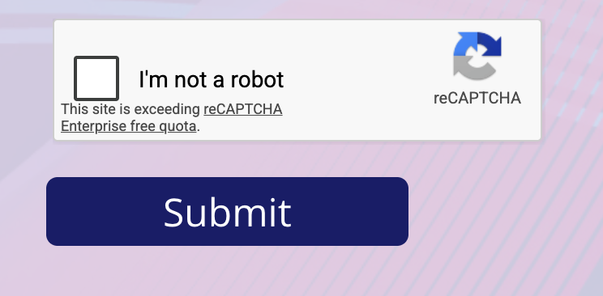
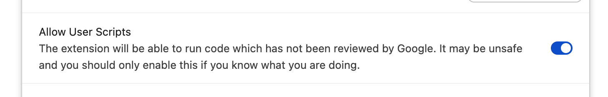

# gc-redeem

[中文](README.zh-CN.md) | English

A Tampermonkey userscript that automates redeeming gift-card links from Gmail
(giftcards.com → Visa virtual account registration)
and collects the issued card numbers into a TSV file.

> **Not affiliated with giftcards.com.** Use at your own risk.

## Quick start

1. Install [Tampermonkey](https://www.tampermonkey.net/) (Chrome/Edge: also turn
   on "Allow User Scripts" — see Install below).
2. **[Install the script (latest release)](https://github.com/bviypz/gc-redeem/releases/latest/download/gc-redeem.user.js)** → click **Install** in the Tampermonkey tab.
3. Open your Gmail message with the "Redeem now" links → Tampermonkey menu →
   **GC: Settings**, fill in your profile once.
4. Tampermonkey menu → **GC: Redeem all gift cards**. Solve each reCAPTCHA
   manually; card numbers are saved automatically.
5. Tampermonkey menu → **GC: Download card data (TSV)** when done.

## How it works

1. Open the Gmail message containing your "Redeem now" links.
2. Tampermonkey menu → **GC: Settings** — fill in the registration profile once
   (name, address, email…). Stored only in Tampermonkey on your browser.
3. Tampermonkey menu → **GC: Redeem all gift cards** — opens every redeem link,
   fills the email + registration form on each, and stops at the reCAPTCHA.
   **You** solve it manually on each tab: tick the **I'm not a robot**
   checkbox, then click **Submit**:

   

   The script detects the issued card after submit and saves its number
   automatically.
4. Each issued card number is saved automatically. Tampermonkey menu →
   **GC: View collected cards** to review, or **GC: Download card data (TSV)**
   to export (`order_number, card_number, valid_thru, cvv, redeemed_at,
   collected_at, status`).

Already-redeemed cards are handled: claiming goes straight to the card detail
page and the card is scraped directly. After a successful claim the
giftcards.com tab closes itself once the order number has been handed off
(never in debug mode).

## Install (first time)

1. Install the **Tampermonkey** browser extension:
   [Chrome](https://chromewebstore.google.com/detail/tampermonkey/dhdgffkkebhmkfjojejmpbldmpobfkfo) ·
   [Edge](https://microsoftedge.microsoft.com/addons/detail/tampermonkey/iikmkjmpaejbjikekkigoigdjldjjbkj) ·
   [Firefox](https://addons.mozilla.org/firefox/addon/tampermonkey/).
2. **Chrome/Edge only — turn on "Allow User Scripts".** Chrome blocks extensions
   from running user scripts until you opt in. Go to `chrome://extensions`
   (`edge://extensions` on Edge), find **Tampermonkey** → **Details**, and turn
   on **Allow User Scripts**. Without this the script installs but silently
   does nothing (its title shows grey in the Tampermonkey menu).

   

   > The extension will be able to run code which has not been reviewed by
   > Google. It may be unsafe and you should only enable this if you know
   > what you are doing.
3. Click this install link (always the latest release):
   [gc-redeem.user.js](https://github.com/bviypz/gc-redeem/releases/latest/download/gc-redeem.user.js)
4. Tampermonkey opens an install tab — click **Install**.
5. Open your Gmail message with the redeem links, then open the Tampermonkey
   menu (puzzle-piece icon → Tampermonkey) and choose **GC: Settings** to fill
   in your registration profile once.

## Privacy

Everything runs locally in your browser. The script makes **zero** network
requests to any third-party server — it only drives the giftcards.com pages
you already visit. Your profile and collected card data live in Tampermonkey
storage on your machine. Verify with DevTools → Network if you like.

## Updating

Tampermonkey checks for updates automatically (based on your Tampermonkey
update-interval setting). When a new release is published here, you'll get an
update notice in Tampermonkey and can install it from the dashboard.

## For maintainers: making a release

1. Bump `// @version` in `gc-redeem.user.js` (Tampermonkey only notices a
   *higher* version).
2. Commit and push, then tag and push the tag:
   `git tag vX.Y.Z && git push origin vX.Y.Z`
3. The `Create release` workflow automatically publishes a GitHub Release for
   the tag with `gc-redeem.user.js` and `gc-redeem.meta.js` attached — that's
   what Tampermonkey polls for updates.

## License

MIT — see [LICENSE](LICENSE).
